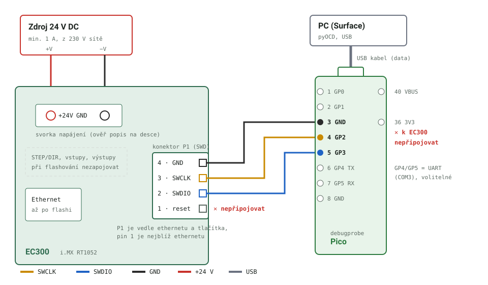

# Nahrání firmwaru Remora do EC300 přes Raspberry Pi Pico

Deska EC300 (NXP i.MX RT1052) se z výroby dodává s firmwarem pro Mach3. Pro LinuxCNC
do ní nahraj firmware [Remora-RT1052](https://github.com/scottalford75/Remora-RT1052-cpp)
přes SWD. Jako programátor stačí Raspberry Pi Pico s firmwarem
[debugprobe](https://github.com/raspberrypi/debugprobe) (CMSIS-DAP).



## Zapojení

SWD konektor **P1** je 4pinový konektor u pravého okraje EC300, hned vedle ethernetového
konektoru a tlačítka. **Pin 1 je nejblíž ethernetu.**

| Pico (fyzický pin) | EC300 P1 | Poznámka |
|---|---|---|
| — | pin 1 · reset | **nezapojovat**, vede na reset obvodu hlídání napájení |
| 5 · GP3 | pin 2 · SWDIO | procesor pad E14 (GPIO_AD_B0_06) |
| 4 · GP2 | pin 3 · SWCLK | procesor pad F12 (GPIO_AD_B0_07) |
| 3 · GND | pin 4 · GND | |
| 36 · 3V3, 40 · VBUS | — | **nepřipojovat** |

- **Napájení:** P1 nemá pin 3,3 V, takže EC300 musí být **napájená ze svého 24 V zdroje**. Pico napájí USB z počítače.
- **Kontrola GND:** před zapojením ověř multimetrem, že pin 4 je GND (při vypnutém napájení pípne proti GND napájecí svorky). Rozložení pinů pochází z popisu autora Remory a může se lišit podle revize desky.
- **Ostatní kabely:** drivery motorů, vřeteno a ethernet při flashování odpoj.
- **Opatrně s deskou:** plošky konektoru jsou křehké a při vytahování desky z krabičky se dají poškodit.

## Příprava Pica

1. Stáhni `debugprobe_on_pico.uf2` z [vydání debugprobe](https://github.com/raspberrypi/debugprobe/releases).
2. Drž tlačítko BOOTSEL, připoj Pico přes USB a soubor zkopíruj na disk `RPI-RP2`.
3. Pico se ohlásí jako **CMSIS-DAP**. Ve Windows ani v Linuxu nepotřebuje ovladače.

## Záloha a nahrání (pyOCD)

```
pip install pyocd
pyocd list                          # musí najít "Debugprobe on Pico (CMSIS-DAP)"
```

Záloha původního firmwaru (celá 4 MB flash):

```
pyocd commander -t mimxrt1050_quadspi -f 1M
> savemem 0x60000000 0x400000 ec300_original.bin
> exit
```

Nahrání Remory. Při prvním nahrání smaž celou flash (`-e chip`), aby v ní nezůstala data Mach3:

```
pyocd flash -t mimxrt1050_quadspi -f 1M -e chip --base-address 0x60000000 remora-rt1052-3.1.3.bin
```

- **Target:** EC300 má flash typu QSPI, proto target `mimxrt1050_quadspi`. Samotný `mimxrt1050` je varianta s HyperFlash a pro EC300 nefunguje.
- **Když se pyOCD nepřipojí:** zkontroluj napájení a GND a zkus nižší frekvenci `-f 500k`.
- **Záloha** obsahuje firmware výrobce. Nech si ji pro sebe a nezveřejňuj ji.

## Po nahrání

1. Vypni a zapni EC300 a odpoj Pico.
2. Propoj EC300 ethernetovým kabelem s Raspberry Pi (`eth0`, Pi má 10.10.10.11, deska 10.10.10.10).
3. V OpenCNC Web otevři **F1 → Řízení a deska**. Deska musí odpovídat.
4. V **F1 → Uložit a použít** nahraj konfiguraci stroje do desky.

Firmware jde nahrát i z Raspberry Pi: připoj Pico k USB portu Pi, nainstaluj pyOCD
(`pipx install pyocd`) a použij **F1 → Aktualizace → Firmware EC300**.

## Zdroje

- [Fórum LinuxCNC: Remora NVEM / EC300 / EC500, strana 47: konektor P1 a zapojení SWD](https://forum.linuxcnc.org/18-computer/44828-remora-ethernet-nvem-cnc-board?start=460)
- [Fórum LinuxCNC: strana 54: tři piny SWD, deska musí být napájená](https://forum.linuxcnc.org/18-computer/44828-remora-ethernet-nvem-cnc-board?start=530)
- [Dokumentace Remora: NVEM/EC300/EC500](https://remora-docs.readthedocs.io/en/latest/hardware/Ethernet/rt1052.html)
